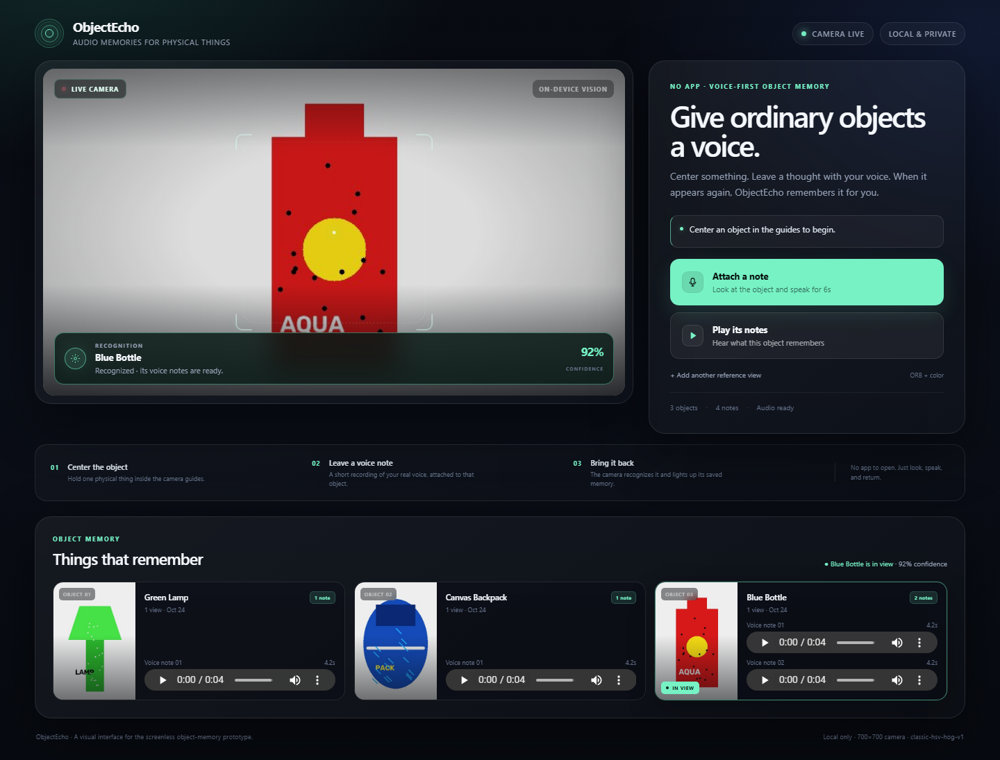

# ObjectEcho

**Attach audio notes to real-world objects.**

ObjectEcho is a working hackathon MVP for the **No App** track: point a camera
at an ordinary object, leave a voice note, and later bring the same object back
to hear that note. The webcam and keyboard are a stand-in for a future wearable
camera and voice interface.

The primary demo is a polished **local web interface** with a live camera feed,
continuous recognition status, captured reference images, and playable voice
notes. A keyboard-first OpenCV app remains available as a screenless fallback.



*Web UI preview. The camera feed and objects in this documentation image are
synthetic test data, not a claim about a physical demo run.*

## The problem

Physical objects carry useful context that software usually cannot see:
*"This is the spare key for the garage,"* *"The charger only works in this
outlet,"* *"Add the blue filter to this coffee."* Phones require an app, a login,
a screen, and a deliberate search. ObjectEcho asks: what if an object itself
could carry a voice memory?

## What works

- Local browser UI with a live camera feed, center-object reticle, continuous
  recognition status, match score, captured images, and playable notes.
- Attach a real WAV voice recording (default 6 seconds) to the centered object.
- Multiple objects and multiple notes per object.
- Instance re-identification using **CLIP global embeddings + ORB local feature
  matching + geometric RANSAC verification**, with a multiple-reference-view
  gallery per object.
- Strict by default: high score, top-two margin, and local ORB evidence gates.
- Explicit candidate confirmation for ambiguous captures. The app never silently
  attaches or plays audio for an uncertain identity.
- Live “IN VIEW” status and card highlighting when a registered object returns
  to the camera.
- SQLite persistence across application restarts, including captured reference
  images, embeddings, ORB features, and WAV recordings.
- Audible recording cues, no-match/ambiguity cues, and optional offline TTS for
  the legacy app.
- Fully local operation. No cloud API or paid service is required.

## Important: no object detector

There is **no YOLO/SSD/segmentation/gaze model** and no bounding-box detection.
ObjectEcho assumes the target is centered and only compares the central crop
with registered identities.

Recognition combines:

1. A **CLIP `ViT-B-32/openai`** global image embedding (or an offline HSV/HOG
   descriptor if CLIP is unavailable).
2. **ORB** local keypoints with Lowe ratio filtering and RANSAC homography
   verification inside a central object mask.
3. Per-view fusion of `0.40 * global + 0.60 * local`, followed by strict
   acceptance gates.

CLIP similarity is semantic and is never enough by itself. The displayed
percentage is a **match score**, not a calibrated probability. See
[How recognition works](#how-recognition-works) for defaults and tuning.

## What you need

For the complete demo:

- Windows 11 (or Linux for development; see WSL notes below).
- Python **3.11–3.13**, 64-bit.
- Webcam, microphone, and speakers/headphones.
- Windows camera and microphone permissions enabled.
- Internet on the first CLIP-enabled run to download model weights. Internet is
  not needed on subsequent runs or when using the classical fallback.

The implementation was tested with Python 3.13 on Windows 11 and Python 3.12 on
Linux/WSL.

## Quick start: Windows PowerShell

From the repository root:

```powershell
py -3.12 -m venv .venv
Set-ExecutionPolicy -Scope Process -ExecutionPolicy Bypass
.\.venv\Scripts\Activate.ps1
python -m pip install --upgrade pip
python -m pip install -r requirements.txt
```

`requirements.txt` includes OpenCV, NumPy, sounddevice, soundfile, Flask, and the
test runner. These core dependencies are enough to run the classical/ORB
fallback.

### Recommended optional CLIP backend

```powershell
# CPU-only PyTorch; avoid a multi-GB CUDA download on a demo laptop
python -m pip install torch torchvision --index-url https://download.pytorch.org/whl/cpu
python -m pip install "open_clip_torch>=2.24,<4" Pillow
```

If you have a supported NVIDIA GPU, install the matching CUDA build of
`torch`/`torchvision` from <https://pytorch.org/get-started/locally/> first, then
install `open_clip_torch` and `Pillow`. ObjectEcho automatically chooses CUDA when
available, otherwise CPU.

Check the installation:

```powershell
python -c "import cv2, sounddevice, soundfile, flask; print('core ready')"
python -c "import torch, open_clip; print('CLIP ready', torch.__version__)"
```

### Start the web interface

```powershell
python main.py --web
```

The browser opens automatically at <http://127.0.0.1:8000>. If it does not,
open that URL manually. The Flask process owns the camera, microphone, and data;
keep its terminal running.

Start the optional spoken status (legacy app only):

```powershell
python -m pip install -r requirements-tts.txt
python main.py --tts
```

## CLIP model weights and Hugging Face cache

This section matters on a fresh machine or before a live demo.

- The CLIP model is `ViT-B-32/openai`, loaded through `open_clip_torch`.
- On the **first app start** with CLIP installed and `--encoder auto` (default),
  ObjectEcho downloads roughly 350 MB of weights. This can take a minute or more.
- Weights are cached; later starts load from disk and do not re-download.
- The model is loaded once per process and kept in memory.

Typical cache location:

```text
Windows: %USERPROFILE%\.cache\huggingface\hub\models--timm--vit_base_patch32_clip_224.openai
Linux:   ~/.cache/huggingface/hub/models--timm--vit_base_patch32_clip_224.openai
```

### Pre-download before the demo

Run this once while online:

```powershell
python -c "import open_clip; open_clip.create_model_and_transforms('ViT-B-32', pretrained='openai', force_quick_gelu=True)"
```

### Optional cache and token settings

Hugging Face can rate-limit unauthenticated downloads. A token is not required,
but can help on a fresh network:

```powershell
$env:HF_TOKEN = "hf_your_token_here"    # optional
```

To place the cache on another drive, set `HF_HOME` **before** the first download
and before starting the app:

```powershell
$env:HF_HOME = "D:\objectecho-hf-cache"
```

To run offline after the weights have been cached:

```powershell
$env:HF_HUB_OFFLINE = "1"
python main.py --web
```

On Windows, `huggingface_hub` may print a warning about symlinks if Developer
Mode is off. Caching still works; you can set
`$env:HF_HUB_DISABLE_SYMLINKS_WARNING = "1"` to hide the warning. The optional
`requirements-vision.txt` lists the same CLIP packages, but prefer the explicit
CPU-first install commands above so PyTorch and torchvision stay matched.

If the weights cannot be downloaded, ObjectEcho automatically falls back to the
fully offline classical descriptor in `--encoder auto` mode. You can deliberately
skip CLIP and its download with:

```powershell
python main.py --web --encoder classic
```

Explicitly passing `--encoder clip` disables the fallback and will fail with an
actionable error if the model cannot be loaded.

## Exact commands

Primary web interface:

```powershell
python main.py --web
```

Keyboard-first OpenCV interface:

```powershell
python main.py
```

Useful variants:

```powershell
python main.py --web --port 8080       # different web port
python main.py --web --no-browser      # keep server, do not open a browser
python main.py --web --strict          # force strict gates if a config lowered them
python main.py --encoder classic       # skip CLIP and model weights entirely
python main.py --camera 1              # second webcam
python main.py --crop 0.55             # tighter central crop
python main.py --record-seconds 8
python main.py --input-device 1 --output-device 3
python main.py --list-devices          # audio device indexes
python main.py --list-objects          # inspect persisted object memory
python main.py --reset-memory          # delete all objects/views/notes, then exit
python main.py --camera-test           # camera preview only
python main.py --min-score 0.75 --min-margin 0.20 --min-local-for-match 0.65
```

All options can also be set in `config.json`; copy `config.example.json` as a
starting point. `config.json` is optional and git-ignored. Command-line flags
override it. Strict thresholds are the shipped defaults; `--strict` reasserts
them if a config file lowers them.

## Using the web interface

- **Attach a note:** capture the centered object and record 6 seconds from the
  Python machine’s microphone. A card appears with the reference image and an
  audio player for the new WAV.
- **Play its notes:** recognize the centered object and play its saved notes in
  the browser.
- **Add another reference view:** teach an existing object another angle.
- The green **IN VIEW** badge and matching object card update continuously when
  a known object is in the center guides. No click is needed for that status.
- If identity is ambiguous, the UI shows **Confirm identity** with the captured
  image and ranked candidates. Nothing is attached or played until you choose.
- The server binds to `127.0.0.1` by default and is intended for a local,
  single-user demo.

## Legacy keyboard controls

| Key | Action |
| --- | --- |
| **A** | Attach a note to the centered object. |
| **P** | Play notes for the centered object. |
| **R** | Add the current view as another reference image. |
| **L** | List registered objects, views, notes, and paths. |
| **Q** | Quit. |
| **C** | Confirm the best candidate for an ambiguous match. |
| **N** | Create a new object when attach matching is uncertain. |
| **1–9** | Explicitly select a candidate. |
| **X** | Cancel a pending choice. |
| **T** | Speak status (requires `--tts`). |

With `--no-preview`, all keys work in the terminal. With the OpenCV preview
open, click it first if terminal keys are not reaching the app. The preview is a
development aid; the browser is the richer demo interface.

## Three-object demo walkthrough

Use objects with **asymmetric texture, logos, seams, or patterns**: a labeled
bottle, a patterned backpack, and a printed mug/book cover.

1. Start `python main.py --web`. The browser opens.
2. Center object A inside the guides and click **Attach a note**. Speak after the
   rising tone; wait for the ending tone and the new card.
3. Center object B and click **Attach a note**. If it is uncertain, click
   **Create new object**, then speak.
4. Repeat for object C.
5. Move objects/camera. Center A again. Its card should highlight with **IN
   VIEW**; click **Play its notes**.
6. Center B and play its distinct note.
7. Optional: attach a second note to A and play both from the card.
8. Stop the server (Ctrl+C), restart `python main.py --web`, and center A. The
   same images, notes, and recognition state return from SQLite.

For the legacy keyboard walkthrough, start `python main.py`, click the preview,
and use this sequence (press **N** only if an uncertainty panel appears):

```text
A  [speak]  A  N  [speak]  A  N  [speak]  P  P  A  [speak]  P  L  Q
```

## How recognition works

There is no full-scene object detector. Every recognition pass takes the central
square crop (60% of the shorter frame dimension by default) and compares it with
all saved reference views.

1. **Global channel:** normalize a CLIP embedding, or use the offline HSV/HOG
   descriptor when CLIP is unavailable. Compare it by cosine similarity with
   every saved view.
2. **Local instance channel:** extract up to 1,200 ORB keypoints inside a central
   elliptical mask (70% × 82% of the crop by default), apply a Lowe ratio test,
   and verify matches with a RANSAC homography.
3. **Fusion:** per view, `score = 0.40 * global + 0.60 * local`; the best view for
   each object wins. If no compatible global embedding exists, the ORB-only
   score is used.
4. **Strict automatic acceptance:** a match requires **all** of:
   - match score ≥ `0.68` (`min_score`),
   - margin over the second object ≥ `0.15` (`min_margin`),
   - ORB local score ≥ `0.55` (`min_local_for_match`).
5. Anything plausible below those gates is treated as uncertain and requires an
   explicit candidate choice. High semantic CLIP similarity alone is never
   accepted.

The displayed score is a matching score, not a probability. The terminal prints
raw cosine similarity, local score, inlier counts, object IDs, and margins.

### If matching is too permissive or too conservative

Strict defaults are deliberate. If backgrounds still cause false positives:

- Ensure the object fills the central guides; otherwise desk/background texture
  becomes part of the local evidence.
- Reset contaminated memory and re-enroll with a few clean views rather than
  stacking many cluttered views.
- Tighten further, for example:

```powershell
python main.py --web --min-score 0.75 --min-margin 0.20 --min-local-for-match 0.65
```

If valid objects stop matching, use **Add another reference view** from the
actual angle/lighting and check that the object fills the reticle.

Identical physical objects cannot be reliably distinguished. The system reports
ambiguity rather than silently choosing one.

## Architecture

```text
main.py         CLI entry, legacy OpenCV app, and --web switch
web_server.py   Threaded Flask server, live camera/recognition service, JSON API
templates/      Single-page web interface (HTML/CSS/JS)
camera.py       Persistent OpenCV VideoCapture with Windows backend fallback
vision.py       CLIP/classic encoder, ORB matching, ranking and decision gates
storage.py      SQLite persistence and relative-path handling
audio_io.py     sounddevice recording/playback, beeps, optional TTS
config.py       JSON configuration, CLI overrides, validation
keyboard.py     Non-blocking terminal keys
tests/          Storage, ranking, persistence, audio, Flask API, simulated UI
data/           Runtime SQLite DB, reference images, and WAV recordings
```

The web server runs one camera reader, one live-recognition loop, and a threaded
Flask API. The browser receives a local MJPEG preview and JSON state; it does not
access the webcam directly. The same tested Python recognition and audio code is
used by both interfaces. The database uses WAL mode and stores file paths
relative to the data directory where possible.

## Data, privacy, and reset

Default data layout:

```text
data/
  objectecho.sqlite3
  objects/<object-id>/obs_*.jpg
  objects/<object-id>/obs_*_orb.npz
  recordings/<object-id>/*.wav
```

The location can be changed with `--data-dir`. On a Windows runtime driving a
WSL-hosted checkout, use a Windows-local data directory so SQLite does not run
over the WSL network filesystem. Recordings are stored unencrypted and are never
sent to a cloud API. Obtain consent before recording people.

### Reset object memory

Stop the app/server, then run the reset against the same data directory the app
uses:

```powershell
python main.py --reset-memory --data-dir "$env:USERPROFILE\objectecho-data"
```

It prints object/view/note counts and requires typing `RESET`. Non-interactive:

```powershell
python main.py --reset-memory --yes --data-dir "$env:USERPROFILE\objectecho-data"
```

This deletes the SQLite database, reference images, and WAV notes, leaving
unrelated files in the data directory alone. Restart the app afterward.

## Running from a WSL-hosted checkout

WSL is useful for editing and tests, but stock WSL does not normally expose a
Windows webcam, microphone, or speakers. WSLg can display GUI windows, but the
live demo should run natively in Windows.

### Tests in WSL

```bash
cd /path/to/ObjectEcho
python3 -m venv .venv
source .venv/bin/activate
sudo apt update && sudo apt install -y libgl1 libportaudio2 v4l-utils
python -m pip install -r requirements.txt
python -m pytest -q
```

WSL audio/microphone access may still be unavailable depending on WSLg and
device forwarding. Use Windows for the demo.

### Windows hardware with source left in WSL

Open **Windows PowerShell**, not a WSL shell. Replace the distro/user/path
placeholders with your own:

```powershell
cd \\wsl.localhost\<Distro>\home\<user>\path\to\ObjectEcho

py -3.13 -m venv "$env:USERPROFILE\objectecho-win\.venv"
& "$env:USERPROFILE\objectecho-win\.venv\Scripts\python.exe" -m pip install --upgrade pip
& "$env:USERPROFILE\objectecho-win\.venv\Scripts\python.exe" -m pip install -r requirements.txt

# Optional CLIP backend
& "$env:USERPROFILE\objectecho-win\.venv\Scripts\python.exe" -m pip install torch torchvision --index-url https://download.pytorch.org/whl/cpu
& "$env:USERPROFILE\objectecho-win\.venv\Scripts\python.exe" -m pip install "open_clip_torch>=2.24,<4" Pillow

# Run the WSL-hosted code using Windows camera/audio and local data
& "$env:USERPROFILE\objectecho-win\.venv\Scripts\python.exe" main.py --web `
  --data-dir "$env:USERPROFILE\objectecho-data"
```

The Linux `.venv` cannot be used by Windows Python. External USB cameras can
sometimes be forwarded with `usbipd-win`, but microphone/speaker forwarding into
WSL is less reliable; native Windows is recommended for the demonstration.

## Testing

From the repository root:

```powershell
python -m pytest -q
```

Current result: **38 passed, 1 skipped**. The skipped test is the opt-in CLIP
integration test. The default suite covers storage persistence, multiple notes,
thresholds and ambiguity, ORB matching, the ORB-only fallback, WAV handling, the
Flask web API, simulated UI flows, and reset behavior. The GitHub Actions
workflow runs this suite on Python 3.11, 3.12, and 3.13 without requiring camera
or audio hardware.

After installing the optional CLIP dependencies, run the CLIP + ORB integration
test:

```powershell
$env:OBJECTECHO_TEST_CLIP = "1"
python -m pytest -q tests/test_clip_optional.py
```

### Hardware smoke test

The automated hardware checks on the Windows host succeeded: DirectShow opened
the integrated 1280×720 webcam, the default microphone recorded a real 48 kHz
WAV with the start/end cue sequence, and the speakers played it back. The real
`--web` server served the page, reported live camera state, and returned JPEG
frames.

A human holding multiple physical objects, leaving spoken notes, moving away,
returning, and hearing the correct note is **not automated**. Do this manual
check before a demo/video:

1. `python main.py --list-devices` lists the intended microphone and speakers.
2. `python main.py --record-test data\recordings\smoke.wav --record-seconds 3`
   records and saves a real WAV.
3. `python main.py --play-test data\recordings\smoke.wav` plays it back.
4. `python main.py --camera-test` shows a live camera feed; press Q.
5. Start `python main.py --web`, complete the three-object walkthrough, restart
   the server, and confirm recognition and notes persist.

## Troubleshooting

**Camera does not open.** Close Teams/Zoom/OBS/browser camera tabs. Enable
Settings > Privacy & security > Camera > “Let desktop apps access your camera.”
Try `python main.py --camera 1` or `--camera-backend msmf`.

**Microphone or speaker missing / PortAudio error.** Run
`python main.py --list-devices` and use the printed indexes or a unique name
substring via `--input-device` / `--output-device`. Check Windows microphone
permissions. On Linux install `libportaudio2`.

**Web page unreachable.** Keep the Flask terminal running. Check the URL and use
`--port 8081` if port 8000 is occupied. Open the page manually if auto-open is
blocked.

**CLIP download is slow or blocked.** Run
`python main.py --web --encoder classic`; the app remains functional with the
classical descriptor + ORB fallback. After caching, `HF_HUB_OFFLINE=1` can be used.
If needed, set `HF_TOKEN`. The first CLIP-enabled run is the only run that should
download weights.

**False positives.** The target may not fill the reticle, the background may be
contributing ORB/global features, or a reference view may be contaminated. Reset
and enroll clean views. Strict gates are already the default; raise them further
with `--min-score 0.75 --min-margin 0.20 --min-local-for-match 0.65`. There is no
object detector—only registration-based recognition.

**No match for a known object.** Add a reference view from the current angle,
ensure similar lighting, and fill the reticle. Check the printed scores and
inlier counts.

**Inference speed.** CPU CLIP inference after startup is typically tens of
milliseconds. The live loop runs about once per second, not continuously at video
frame rate. Use `--encoder classic` for the lightest runtime or CUDA for speed.

## Known limitations

- Visually identical objects cannot be reliably distinguished.
- Textureless, symmetric, transparent, or reflective objects are difficult for
  ORB and may require explicit confirmation.
- Large viewpoint/lighting changes can drop local matches; add reference views.
- The object must be centered and reasonably fill the reticle. There is no
  detection, segmentation, hand tracking, or gaze tracking.
- The web UI is a local single-user server with no accounts, TLS, or remote
  synchronization. The microphone belongs to the Python host.
- Recording length is fixed per invocation; there is no tap-to-stop yet.
- Match scores are not calibrated probabilities.
- TTS is optional and uses the operating system’s default voice output.
- Everything is stored unencrypted on the local machine.

## Future vision

The webcam and keyboard are stand-ins for a wearable interface: look at an object
and speak to leave a note; look at it again and hear it. Future work includes a
wearable camera, gesture/wake-word triggers, robust long-term instance
re-identification, shared object memories with consent, multi-user
synchronization, and privacy-preserving storage.

ObjectEcho does not claim solved visual identity. It is an honest, working
prototype of object-centric, screenless audio memory.

## License

MIT. See [LICENSE](LICENSE).
